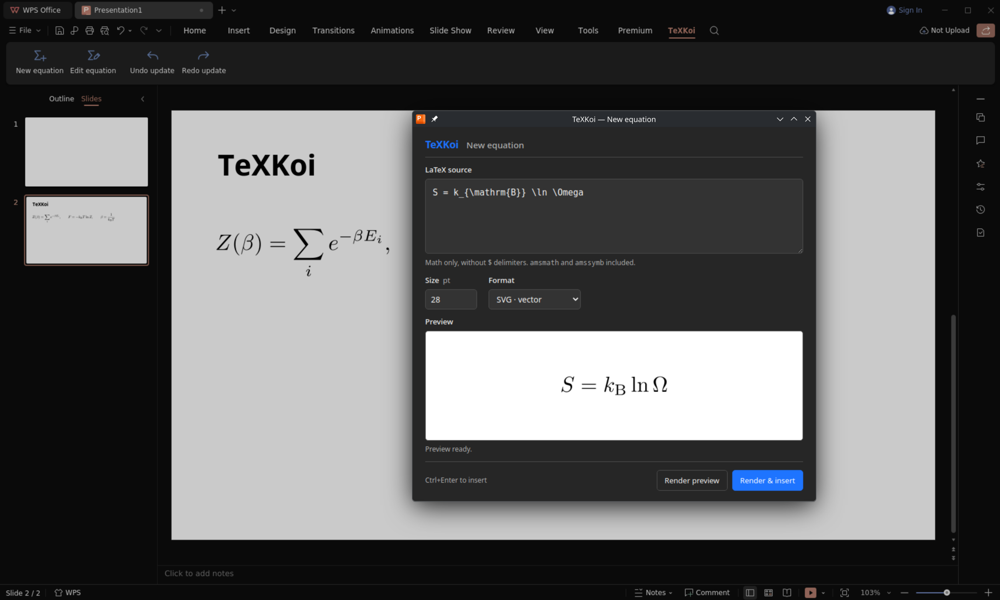

# TeXKoi

TeXKoi brings editable LaTeX equations to **WPS Slides on Linux**.

Inspired by [IguanaTex](https://github.com/Jonathan-LeRoux/IguanaTex). Part of **Reiko Studio**.

**[Installation guide](INSTALL.md)** · [Configuration](CONFIGURATION.md) · [Changelog](CHANGELOG.md)



> [!NOTE]
> This project is in early development and has only been tested on
> Arch Linux with the Chinese version of WPS Office (`wps-office-cn 12.1.2.29183-1`).

## Installation

You will need WPS Slides with JavaScript add-in support, Python 3.10+,
TeX Live, dvisvgm, and Poppler. The current version targets Linux.

Download and extract the source archive, or clone this repository. From the
project folder, run:

```bash
python3 install doctor --render-check
python3 install
```

Restart WPS Slides to see the **TeXKoi** tab. The installer sets up local
rendering and automatic startup for your user account. You can close the
terminal afterward.

The [installation guide](INSTALL.md) covers dependencies, compatibility,
removal, and troubleshooting.

## Your first equation

Open a slide and choose **TeXKoi → New equation**. Enter a LaTeX math fragment,
without surrounding `$` delimiters:

```latex
\int_0^1 x^2\,dx = \frac{1}{3}
```

Choose a size and click **Render preview** to check it, or **Render & insert**
to place it on the slide. The editor closes after insertion, leaving the
equation selected and ready to position.

To change it later, select the equation and choose **Edit equation**. Adjust
the source and click **Render & update**. Your source travels with the equation
when you save and reopen the presentation.

For quicker editing, **Ctrl+Enter** renders and inserts or updates;
**Ctrl+Shift+Enter** previews; **Escape** closes the editor while idle.
Enable **Vim: off** in the editor for optional Vim-style editing; in that mode,
Escape returns to normal mode while a text field is focused. You can make it
the default in your configuration. See the
[supported commands](CONFIGURATION.md#vim-style-editing).

## Your own packages and macros

Set your preferred size and output format, then add packages and macros in a
[custom preamble](CONFIGURATION.md). You can also adjust the preamble for an
individual equation in the editor. Each equation keeps the preamble it was
rendered with, so changing your defaults later leaves older equations intact.

## Troubleshooting

### Undo and redo after an update

On the tested WPS build, a complete equation update takes **Ctrl+Z twice** to
undo and **Ctrl+Y twice** to redo. A single undo can leave both versions visible.

Use TeXKoi's **Undo update** and **Redo update** buttons immediately after an
update, before unrelated edits. They provide a compatibility workaround for
the latest equation update in the current session.

For startup or rendering problems, see the
[troubleshooting guide](INSTALL.md#troubleshooting).

## AI disclosure

TeXKoi is developed with AI assistance from OpenAI Codex, using GPT-6.1 Sol,
for implementation, research, and documentation. All code and functionality
have been reviewed by the project author.

## License

[MIT](LICENSE). IguanaTex is credited as inspiration; TeXKoi does not include
its source code or assets.

[Development notes](DEVELOPMENT.md) · [Installation design](OFFLINE_INSTALLATION.md)
